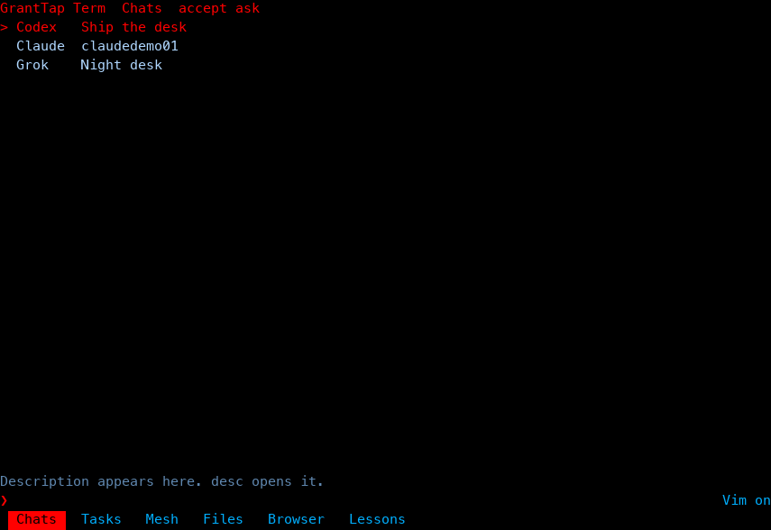
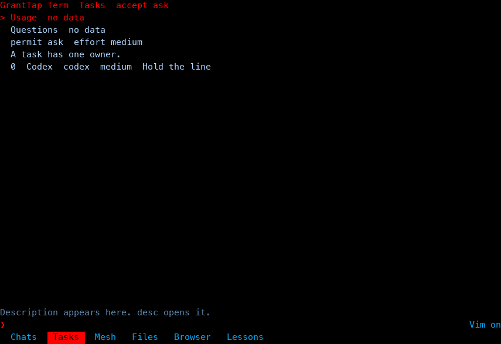
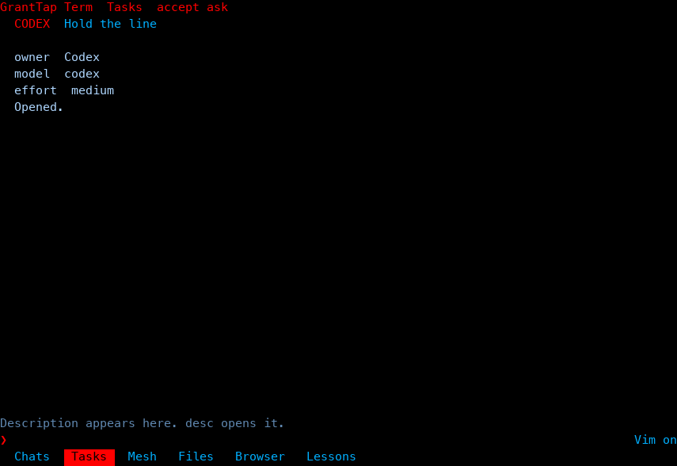
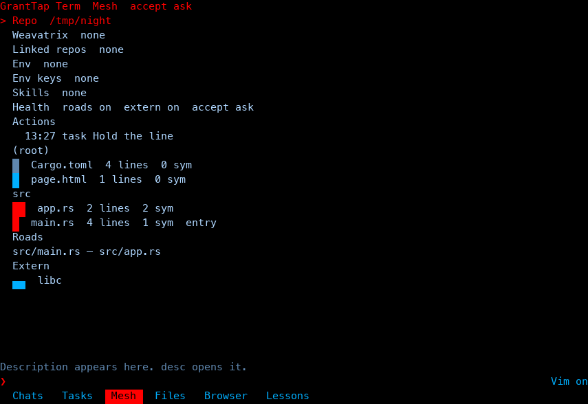
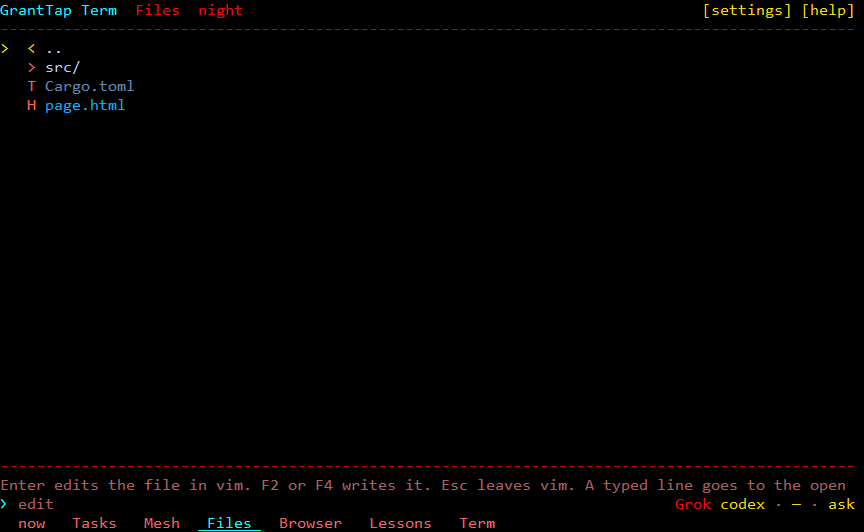
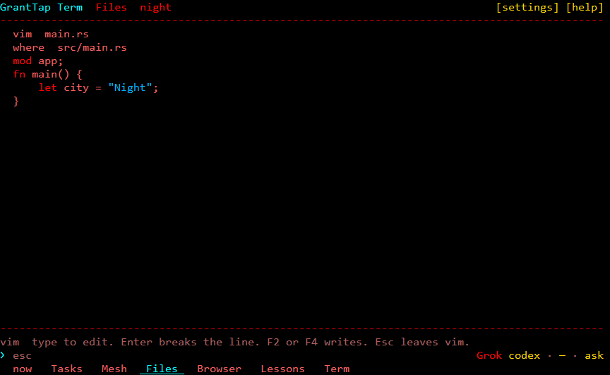
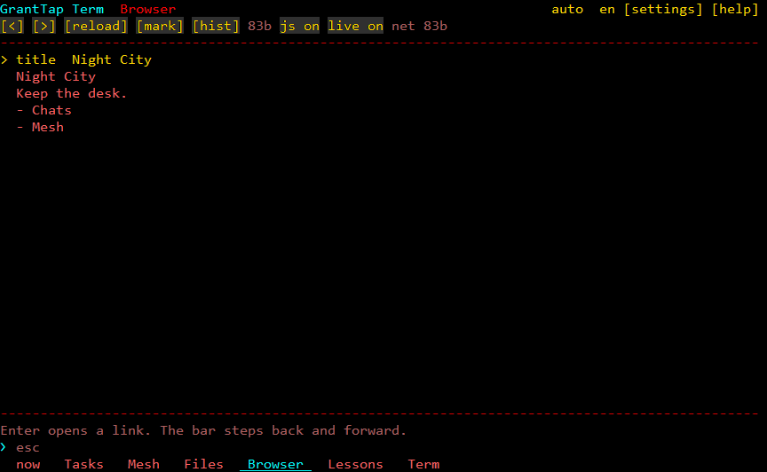
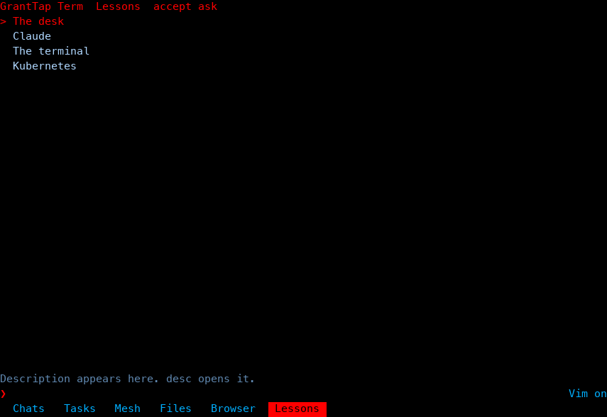

# GrantTap Term

A desk for one machine. It runs inside a terminal that is already open: Windows Terminal, iTerm, or an SSH session. It has no window of its own. It is not a terminal emulator and it is not the GrantTap server.

On one computer the desk shows Grok, Claude, and Codex chats, a task queue, the Weavatrix repository mesh, files, a browser, lessons, and a Term tab. The agents stay on this machine.

The chat tab is `now`. The open talk is on the right, the session list is on the left. The list and the talk have their own scrollbars. The wheel over the list moves the list. The wheel over the talk moves the talk. The top right has `[settings]` and `[help]`. The bottom tabs are now, Tasks, Mesh, Files, Browser, Lessons, and Term.

Repository edits above the talk start as one row, `▶  +N  −M`. A click expands folders and files. Files at `+0 −0` stay hidden. When the list is taller than the screen, the opened row stays at the top, and scrolling back to older lines does not slide that list away.

The default look is cyberpunk: a black field, red, blue, and gold. Settings also has cyberdeck, parchment, ink, dos, and linux. The browser page theme is separate: auto, dark, and light. The console font is Consolas, Cascadia Mono, or Lucida Console, with a cell height of 12, 16, 20, or 24.

The specification is in the `план` folder.

## GrantTap Local

The local MCP is named **granttap-local**. It is not the GrantTap server and it is not a cloud login. Over stdio it is one machine, line-delimited JSON-RPC, with no OAuth. The `initialize` name is `granttap-local` and the version is `1.0.0`.

The desk program is named `granttap-term`. The same binary serves MCP:

```
granttap-term mcp
```

While the desk is open, the same helper listens on `http://127.0.0.1:17342/mcp`. Health check: `http://127.0.0.1:17342/healthz`.

The npm package `granttap-local` installs that program and runs it as MCP. The package build is darwin arm64.

```
npx granttap-local
```

Tools: `list_chats`, `preview_image`, `git_history`, `git_read_blob`, `browse_page`, `list_mesh`, `list_skills`, `read_handoff`, `read_skill`, `browser_session`, `browser_act`. `read_handoff` takes `chat`. `read_skill` takes `skill`. `browser_act` takes `action`.

## Run the desk

From the repository directory:

```
cargo run
```

Without a terminal the program prints `granttap-term: run this inside a terminal` and exits. `granttap-term mcp` also works on a pipe.

Keys: arrows and the mouse move the cursor, Enter opens a row or sends a command, Esc closes an overlay. F2 and F4 edit a file in Vim, F3 or `[full]` expands the chat, F5 refreshes the mesh and the open page, F6 toggles say and queue, F10 quits immediately. Ctrl+C quits on the second press. A drag copies the cells under the pointer. Ctrl+V and Alt+V paste text, a file, or a picture. The full list is `[help]`, or `?` on an empty line.

A picture in a chat is drawn in sextants. A click opens it in a frame. A second click on the frame does not close the chat. A click on a file in the chat opens the text in the same kind of frame.

## Screens

The frames are 96×28.

Chats. A live Grok chat comes from `active_sessions.json` when that process is still alive. Claude and Codex are live only when a process named `claude` or `codex` carries that id. The Grok title is read from `summary.json`. The list keeps the ten newest chats for each agent.



Tasks. A task has one owner, one model, and one effort. Opening a task row splits as that agent. Working chats are above, waiting ones are below.





The mesh is repositories Weavatrix linked by shared commits, not a chat. A row shows a short meter, the line count, and the byte count. Roads follow `mod`, `use crate::`, `use super::`, and relative JS imports. A red `!` names a missing file. External dependencies are separate bands. Names from `.env.example` are visible. Values are not. When there are no links, the desk writes `none`.



Files and the editor. Each file type has its own mark. Vim shows where the file is, when it changed, and which commit that is. The difference from HEAD is marked. Highlighting follows the extension: Rust, Python, JavaScript, TypeScript, Go, shell, and C.





The browser draws a local file or an `http`/`https` page. Headless Edge lays the page out. When Edge does not answer, the text parser remains. The header has the theme and the language. The bar is back, forward, reload, bookmark, history, js, and live.



Lessons: the desk, Claude, the terminal, and Kubernetes. There is no separate pods screen.



## Commands

Suggestions sit above the prompt when the line is empty in an open chat, or when it starts with `/`. A short description sits under the suggestion. `desc` opens that description in the bottom split. Command history is in `~/.granttap-term/desk.txt`.

| Command | What it does |
| --- | --- |
| `chats` `tasks` `mesh` `files` `browser` `lessons` `term` | Switches the tab |
| `task <name>` | Queues a task for the current agent |
| `move grok` `move claude` `move codex` | Hands the selected chat over. Writes `~/.granttap-term/handoff/` and opens a split. Does not rewrite the agent session stores |
| `open` `context` | Opens the chat. `context` adds the recorded context |
| `accept ask` `safe` `except-push` `except-destructive` `full` | Auto-accept for this mesh and the selected chat |
| `pause` | Pauses auto-accept |
| `permit ask` `edits` `bypass` `plan` | Writes the mode into the selected agent's config |
| `model <name>` `effort <level>` | Writes the model and the effort only for the selected agent |
| `image <path>` | Cell preview of a picture |
| `browse <file or url>` | A page in the split |
| `history` `blob <path>` | Git read through Weavatrix |
| `health roads` `health extern` | Turns on roads and external bands for this mesh |
| `skill <name>` | Opens `SKILL.md` |
| `commit` | `git commit`. Adds nothing to the index |
| `push` | `git push` with no extra flags |
| `fill` | Expands the split or collapses it |

`ask` and `safe` do not write on the first Enter. The first Enter leaves the command and says to repeat it. The second Enter runs it. The same applies while paused. `except-push`, `except-destructive`, and `full` run `permit`, `model`, `effort`, `commit`, and the F4 edit immediately. `push` passes immediately only on `except-destructive` and `full`. There is no separate destructive git command.

`permit` writes Grok `[ui] permission_mode`, the top Codex `approval_policy`, and `permissions.defaultMode` in the project's `.claude/settings.local.json`. The desk does not rewrite `~/.claude/settings.json`. Claude model and effort go to the project settings. For Grok that is `[models] default` and `default_reasoning_effort`.

## What the desk shows honestly

No `active_sessions.json` file means the line `no data`. The file is present but there is no live question means `none`. Grok questions are read from a short session tail and from plan wait. The desk does not invent quota: only tokens that are already recorded are shown. The Claude and Codex desktops are not counted as a live CLI chat.

Linked repositories appear only when Weavatrix sees shared commits. Otherwise the line is `Linked repos none`.
